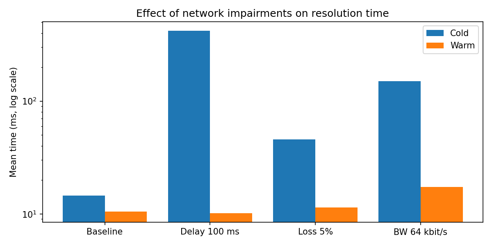
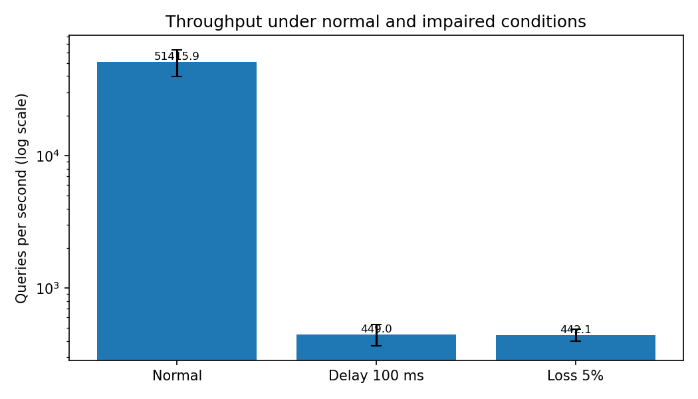
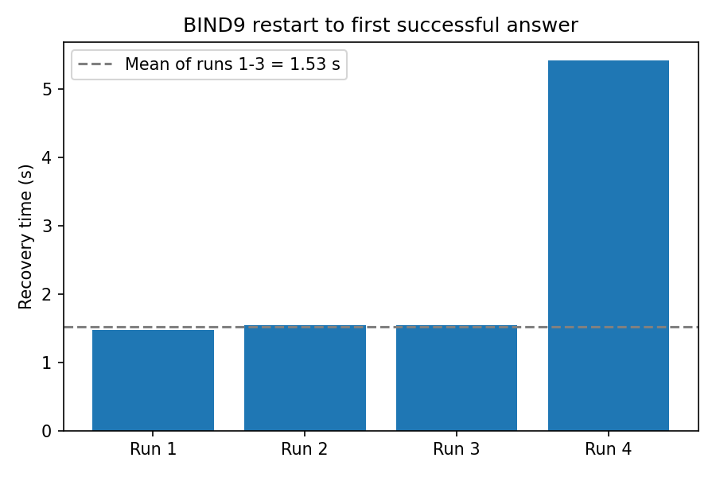

# Local DNS Infrastructure: Authoritative + Caching Resolver with DNSSEC and Failure Analysis

CS3001 Computer Networks

## What it is
A private DNS system running in Docker: an authoritative server (BIND9) for the made-up zone `lab.test`, a caching resolver (Unbound) with DNSSEC validation, and a client, spread over three subnets and two routers. We measure cold vs warm cache, network impairments (delay, loss, low bandwidth), throughput, and what happens when the authoritative server fails.

## Architecture
(see the diagram in the next section)

| Container | Role | IP |
|---|---|---|
| client | runs dig/dnsperf | 10.0.1.10 |
| router1 | router | 10.0.1.254 / 10.0.2.254 |
| resolver | Unbound | 10.0.2.10 |
| router2 | router | 10.0.2.253 / 10.0.3.254 |
| server | BIND9 | 10.0.3.10 |

## Requirements
Windows with WSL2 (Ubuntu) and Docker Desktop with WSL integration on. Run everything in the Ubuntu terminal. For the graphs: `sudo apt install python3-matplotlib`.

## How to run
```bash
git clone https://github.com/silajav/Local-DNS-Infrastructure-Authoritative-Caching-Resolver-with-DNSSEC-and-Failure-Analysis.git
cd Local-DNS-Infrastructure-Authoritative-Caching-Resolver-with-DNSSEC-and-Failure-Analysis
./scripts/setup.sh              # builds and starts the lab, checks DNS and DNSSEC
./scripts/run-all.sh --yes      # runs every experiment (about 6 minutes)
python3 scripts/analyze.py      # tables and graphs
```
Expected output of `setup.sh`: `DNSSEC validation OK (ad flag present).` then `Lab is ready.`

DNSSEC signatures expire 30 days after signing. If they have expired, run `./scripts/setup.sh --resign`.

## Scripts
| Script | Purpose |
|---|---|
| `setup.sh` | Bring the lab up from clean (`--resign` regenerates DNSSEC keys) |
| `sign-zone.sh` | Re-sign the zone and update the trust anchor |
| `capture.sh` | Start/stop tcpdump, save a .pcap to `results/` |
| `impair.sh` | tc netem delay / loss / rate, plus `clear` and `show` |
| `cache-test.sh` | Cold vs warm resolution time to CSV |
| `cache-stats.sh` | Cache hit ratio from unbound-control |
| `load-test.sh` | Queries per second with dnsperf |
| `failure-test.sh` | Stop BIND9, query, restart, time recovery |
| `run-all.sh` | Run every experiment |
| `analyze.py` | Mean, std dev, tables and graphs |

## Results
<Paste the key table(s) from docs/results-tables.md and embed the graphs:>





## Output files
CSV files and `.pcap` captures in `results/`, plan in `docs/experiment-plan.md`, screenshots in `docs/screenshots/`.

## Notes
The private DNSSEC keys are in the repo on purpose (lab only). Never do this with a real domain.
