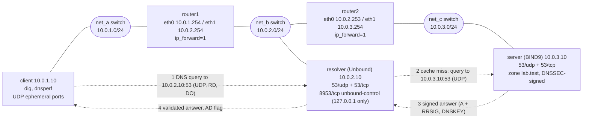
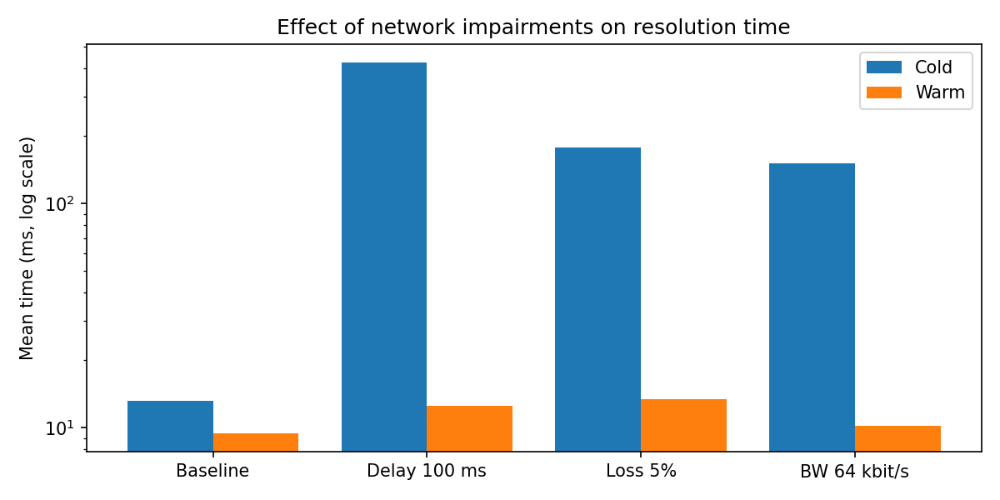
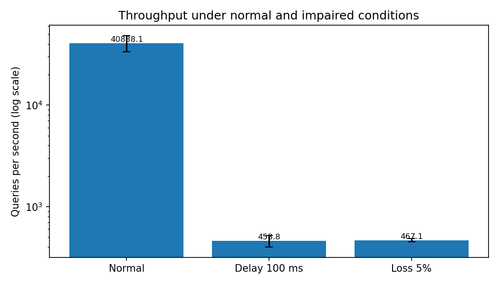
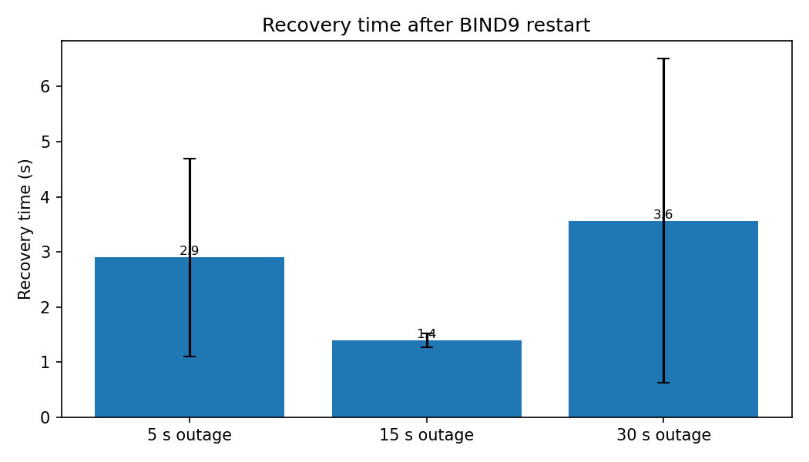

# Local DNS Infrastructure: Authoritative + Caching Resolver with DNSSEC and Failure Analysis

CS3001 Computer Networks

## What it is
A private DNS system running in Docker: an authoritative server (BIND9) for the made-up zone `lab.test`, a caching resolver (Unbound) with DNSSEC validation, and a client, spread over three subnets and two routers. We measure cold vs warm cache, network impairments (delay, loss, low bandwidth), throughput, and what happens when the authoritative server fails.

## Architecture


| Flow | From | To | Protocol / port | Notes |
|---|---|---|---|---|
| Client query | 10.0.1.10 | 10.0.2.10 | DNS, UDP 53 (TCP 53 for +tcp) | Routed via router1 |
| Resolver upstream query | 10.0.2.10 | 10.0.3.10 | DNS, UDP 53 | Routed via router2 |
| DNSSEC validation | resolver | server | DNS, DNSKEY (type 48) | Checked against the DS trust anchor |
| Reachability tests | client | server | ICMP echo, traceroute | Shows both routers as hops |
| Management | inside resolver | Unbound | TCP 8953, loopback only | unbound-control |


| Container | Role | IP |
|---|---|---|
| client | runs dig/dnsperf | 10.0.1.10 |
| router1 | router | 10.0.1.254 / 10.0.2.254 |
| resolver | Unbound | 10.0.2.10 |
| router2 | router | 10.0.2.253 / 10.0.3.254 |
| server | BIND9 | 10.0.3.10 |

## Requirements
Windows with WSL2 (Ubuntu) and Docker Desktop with WSL integration on. Run everything in the Ubuntu terminal. For the graphs: `sudo apt install python3-matplotlib`.

## How to run
```bash
git clone https://github.com/silajav/Local-DNS-Infrastructure-Authoritative-Caching-Resolver-with-DNSSEC-and-Failure-Analysis.git
cd Local-DNS-Infrastructure-Authoritative-Caching-Resolver-with-DNSSEC-and-Failure-Analysis
./scripts/setup.sh --resign     # builds and starts the lab, checks DNS and DNSSEC
./scripts/run-all.sh --yes      # runs every experiment (about 15 minutes)
python3 scripts/analyze.py      # tables and graphs
```
Expected output of `setup.sh`: `DNSSEC validation OK (ad flag present).` then `Lab is ready.`

> **Note:** DNSSEC signatures expire 30 days after signing. Always include `--resign` on first setup so expired signatures do not cause `SERVFAIL` errors.

## Scripts
| Script | Purpose |
|---|---|
| `setup.sh` | Bring the lab up from clean (`--resign` regenerates DNSSEC keys) |
| `sign-zone.sh` | Re-sign the zone and update the trust anchor |
| `capture.sh` | Start/stop tcpdump, save a .pcap to `results/` |
| `impair.sh` | tc netem delay / loss / rate, plus `clear` and `show` |
| `cache-test.sh` | Cold vs warm resolution time to CSV |
| `cache-stats.sh` | Cache hit ratio from unbound-control |
| `hitratio-test.sh` | Cache hit ratio per run: flush, 21 queries, record hits and misses |
| `load-test.sh` | Queries per second with dnsperf |
| `failure-test.sh` | Stop BIND9, query, restart, time recovery |
| `run-all.sh` | Run every experiment |
| `analyze.py` | Mean, std dev, tables and graphs |

## Results

Mean and sample standard deviation (n-1) per condition. Only NOERROR answers are averaged; failures are counted separately.

### Resolution time (cache-test.sh)

Times are the wall-clock time of one `dig` inside the client container. They include a few ms of dig start-up that is the same in every condition, so compare conditions with each other rather than reading absolute values.

| Condition | Cache | Runs OK | Failed | Mean (ms) | Std dev (ms) |
|---|---|---|---|---|---|
| Baseline | cold | 3 | 0 | 13.2 | 5.4 |
| Baseline | warm | 3 | 0 | 9.5 | 1.0 |
| Delay 100 ms | cold | 3 | 0 | 424.8 | 0.6 |
| Delay 100 ms | warm | 3 | 0 | 12.5 | 8.1 |
| Loss 5% | cold | 10 | 0 | 177.6 | 254.5 |
| Loss 5% | warm | 10 | 0 | 13.4 | 4.6 |
| BW 64 kbit/s | cold | 3 | 0 | 151.4 | 8.3 |
| BW 64 kbit/s | warm | 3 | 0 | 10.2 | 1.4 |

### Cache hit ratio (hitratio-test.sh / cache-stats.sh)

| Condition | Runs | Mean hits | Mean misses | Mean hit ratio (%) | Std dev (%) |
|---|---|---|---|---|---|
| baseline | 3 | 18.0 | 3.0 | 85.7 | 0.0 |
| delay100 | 3 | 18.0 | 3.0 | 85.7 | 0.0 |
| loss5 | 3 | 18.0 | 3.0 | 85.7 | 0.0 |

### Throughput (load-test.sh, dnsperf)

| Condition | Runs | Mean QPS | Std dev QPS | Mean lost (%) |
|---|---|---|---|---|
| Normal | 3 | 40838 | 7359 | 0.00 |
| Delay 100 ms | 3 | 459 | 58 | 0.00 |
| Loss 5% | 3 | 467 | 19 | 9.68 |

### Authoritative server failure and recovery (failure-test.sh)

| Outage length (s) | Runs | Mean recovery (s) | Std dev (s) | Min (s) | Max (s) |
|---|---|---|---|---|---|
| 5 | 3 | 2.90 | 1.79 | 1.81 | 4.97 |
| 15 | 3 | 1.40 | 0.13 | 1.26 | 1.51 |
| 30 | 3 | 3.56 | 2.94 | 0.66 | 6.54 |

Recovery = seconds from restarting BIND9 until the first NOERROR answer. The run recorded while tcpdump was running is reported separately.






## Output files
CSV files and `.pcap` captures in `results/`, plan in `docs/experiment-plan.md`, screenshots in `docs/screenshots/`.

## Notes
The private DNSSEC keys are in the repo on purpose (lab only). Never do this with a real domain.
